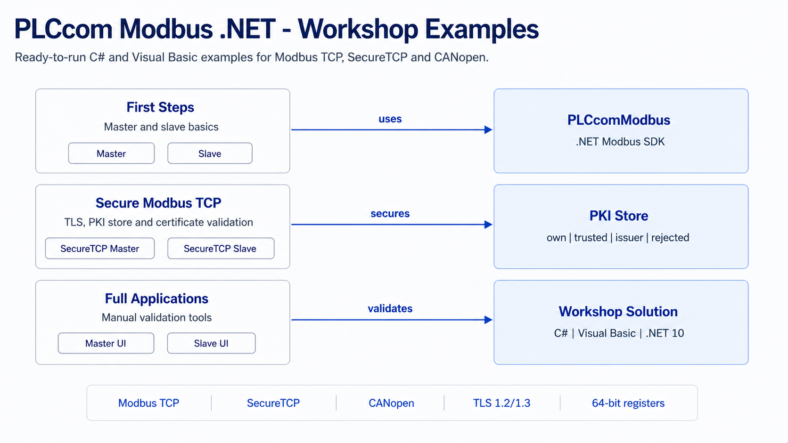

# PLCcom Modbus - .NET Workshops

  

<!--
Optional repository image slot:
Add your screenshot or overview graphic as assets/plccom-modbus-workshops.png and uncomment the next line.

-->

Modbus looks simple at first glance: a unit id, a function code, an address, a few registers. In real projects, the interesting work starts exactly around those details. Which byte order does the device expect? Which register width represents the value? How do you prove what was sent on the wire? What happens when the transport is secured with certificates instead of being plain TCP?

This repository is built around those questions. It is not a bag of unrelated snippets. It is a small workshop path for developers and integrators who want to learn PLCcom Modbus by running working pairs: start a slave, connect a master, watch the telegrams, change one thing, run it again.

The examples are intentionally close to the code you would write in a real integration. The small console workshops keep the moving parts visible. The full applications are richer manual validation tools for the day when a real device is on the desk and you need to see what is going on.

## What You Will Find Here

| Area | What it teaches |
|------|-----------------|
| First Steps | Plain Modbus TCP with one master and one slave, including read and write requests. |
| Secure Modbus TCP | TLS, PKI store layout, certificate trust, mutual TLS, and authorization callbacks. |
| CANopen | CANopen-style object dictionary access through Modbus communication. |
| Full Applications | Windows Forms master and slave applications for manual checks, troubleshooting, and validation. |

The C# and Visual Basic folders follow the same structure so that teams can compare both languages without learning two different repositories.

## Repository Layout

~~~text
CSharp/
  1 First Steps/
  2 Secure Modbus TCP/
  3 CANopen/
  9 Full Applications/

VisualBasic/
  1 First Steps/
  2 Secure Modbus TCP/
  3 CANopen/
  9 Full Applications/
~~~

Each workshop contains its own README and source file. Start with the README in the chapter folder, then open the numbered project.

## Recommended Learning Path

| Step | Start here | Why |
|------|------------|-----|
| 1 | `12_Simple_Slave_TCP` | Run a predictable local slave before connecting to anything external. |
| 2 | `11_Simple_Master_TCP` | Read and write against that slave and inspect the request/response flow. |
| 3 | `21_SecureTCP_Master` and `22_SecureTCP_Slave` | Add TLS and learn how the PKI store decides what is trusted. |
| 4 | `23_MutualTLS_Loopback` | See both certificates in one compact loopback scenario. |
| 5 | `24_RoleBasedAuthorization` | Learn where an integrator can decide whether a role may execute a function. |
| 6 | `91_Full_Master_Sample` and `92_Full_Slave_Sample` | Move from small teaching code to full manual validation tools. |

## NuGet Package

The projects reference the **PLCcomModbus** package from the PLCcom Modbus **9.x** line. The exact package version is pinned in the project files so that the samples build reproducibly.

If the required package is not yet available on nuget.org, add the package source provided with your PLCcom Modbus build or wait until the matching 9.x package has been published.

## Requirements

- Windows 10/11 or Windows Server for the full Windows Forms applications
- .NET 10 SDK
- Visual Studio 2022 or newer, Visual Studio 2026 recommended
- A valid PLCcom Modbus license user name and serial number
- A Modbus device, simulator, or one of the included slave workshops

## Getting Started

1. Clone the repository.
2. Open `PLCcom_Modbus_Examples.sln` in Visual Studio.
3. Open the workshop README for the sample you want to run.
4. Replace the visible license placeholders in the source code or application settings.
5. Start the matching slave first, then start the master.

Command-line build after the matching package is available:

~~~powershell
dotnet restore .\PLCcom_Modbus_Examples.sln
dotnet build .\PLCcom_Modbus_Examples.sln -c Debug
~~~

## Workshop Map

### C# Workshops

| # | Workshop | Short description |
|---|----------|-------------------|
| 11 | Simple Master TCP | Connects to a slave, writes registers, reads them back, and prints diagnostic output. |
| 12 | Simple Slave TCP | Hosts a small Modbus TCP slave for the master workshop. |
| 21 | SecureTCP Master | Shows the master-side SecureTCP setup with TLS and PKI store configuration. |
| 22 | SecureTCP Slave | Hosts a SecureTCP listener and demonstrates certificate trust handling. |
| 23 | Mutual TLS Loopback | Runs master and slave in one process so the complete TLS handshake is visible. |
| 24 | Role Based Authorization | Demonstrates how a slave-side validator can decide by role and Modbus function. |
| 31 | CANopen Master | Reads and writes CANopen-style object dictionary entries over Modbus. |
| 91 | Full Master Sample | Complete Windows Forms master application for manual validation. |
| 92 | Full Slave Sample | Complete Windows Forms slave application with TCP and SecureTCP listeners. |

### Visual Basic Workshops

The Visual Basic projects mirror the same workshop numbers and topics. Use them when your integration codebase is VB.NET or when you want to compare both language styles side by side.

## Secure Modbus TCP and the PKI Store

SecureTCP uses TLS certificates. PLCcom creates the PKI store structure on first access when it does not exist yet. The important folders are:

| Folder | Meaning |
|--------|---------|
| `own` | Local endpoint certificates. |
| `own/private` | Private keys for local endpoint certificates. |
| `trusted` | Remote certificates that are explicitly trusted. |
| `issuer` | Issuer or CA certificates used to validate certificate chains. |
| `rejected` | Unknown or rejected remote certificates that need review. |

Without a custom validator, PLCcom performs certificate validation against this store. A certificate with a valid chain and validity period can be trusted. Unknown certificates are placed in `rejected` so that an operator or integrator can inspect them and move them deliberately.

Some workshops use a permissive validator on purpose. That is a teaching tool. It shows where your own policy can hook in, but it is not a security policy for production systems.

## Full Applications

The full master and slave applications are not decorative demos. They are meant for real manual validation: try plain TCP and SecureTCP, inspect logs, check byte order and register modes, review certificate handling, and compare the behaviour against an actual device or customer setup.

When a console workshop feels too small for a field issue, the full applications are the next stop.

## Licensing Information

**Examples License**

All example sources in this repository are released under the **MIT License**. You may use, modify, and distribute the examples according to the license terms.

**PLCcom Library License**

The **PLCcom Modbus** library itself is proprietary software and is not part of the MIT license. To use the SDK in your own applications, you need a valid PLCcom Modbus license and must accept the applicable EULA.

## Safety Notice

The examples are written for learning, integration tests, and manual validation. Do not use them unchanged in production, safety-critical, or industrial environments. Review addresses, write operations, timeouts, TLS settings, certificate trust, and authorization logic before connecting to real equipment.

## Trademark Information

All product names, company names, and trademarks referenced in this repository are trademarks or registered trademarks of their respective owners. Their use is solely for identification and interoperability documentation.

